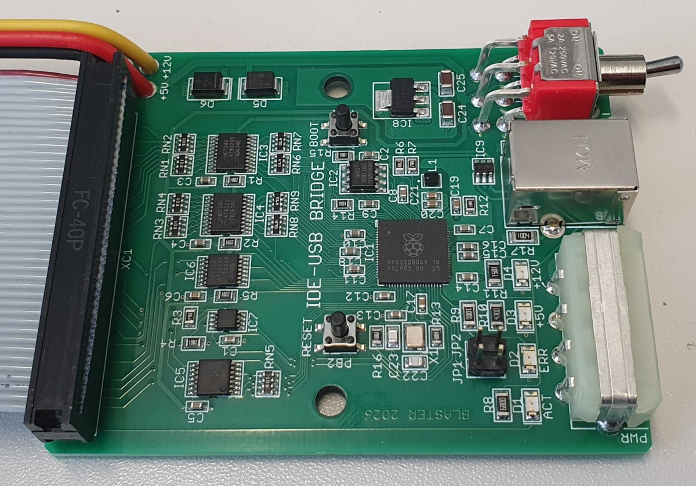
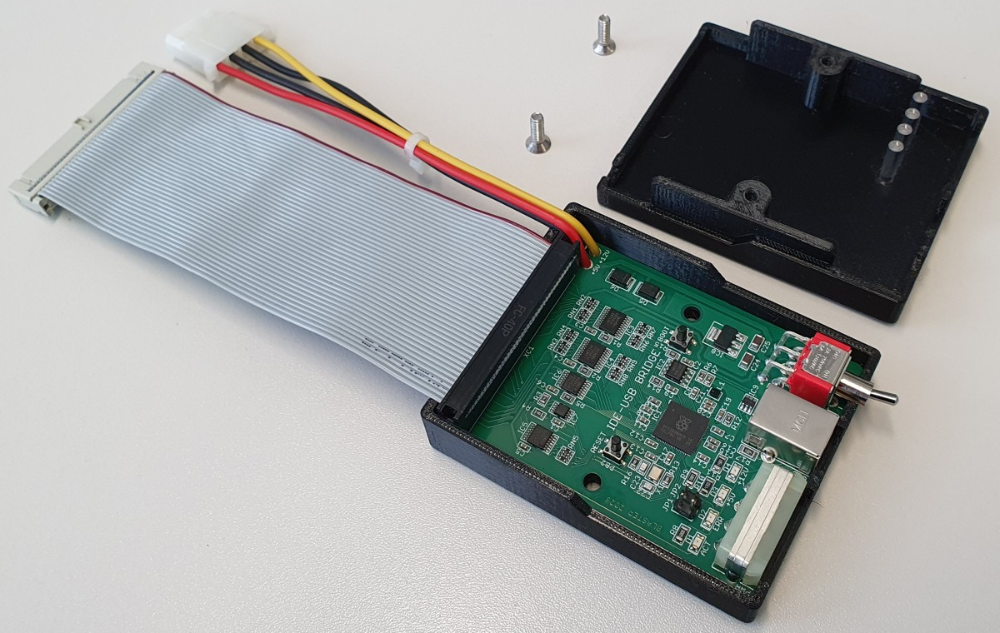
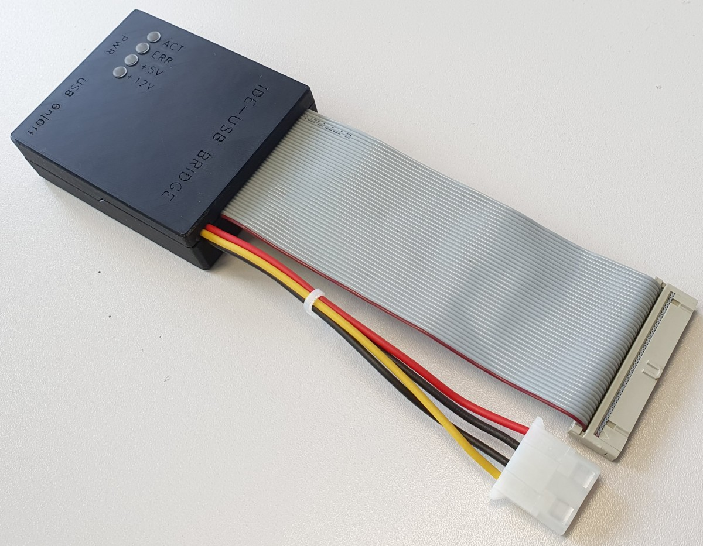
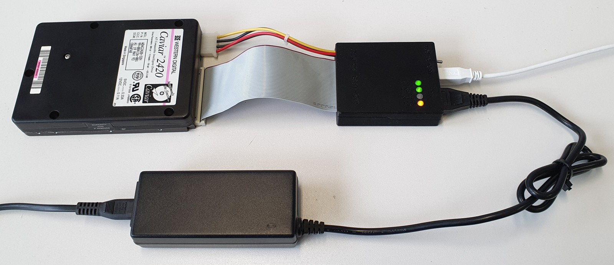
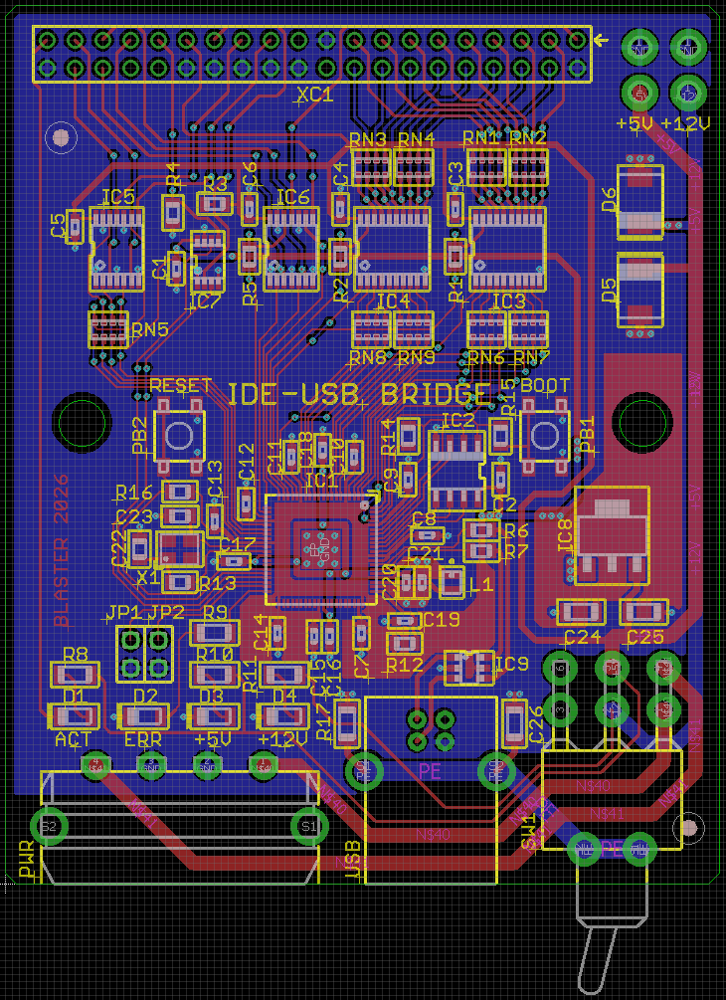
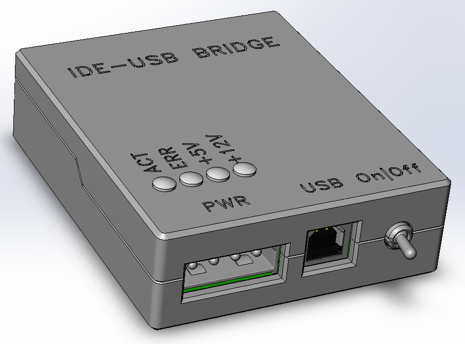

# IDE-USB Bridge
### Interface for old ATA Drives running in CHS Mode

Based on original ATAboy design by [JJ Dasher](https://github.com/redruM0381/ATAboy)

\
**List of changes compared to the original ATAboy rev. 0.5:**

- Added power passthrough with mechanical switch for HDD power (power is switched together for HDD and interface)
- Added LEDs for both switched voltages
- Interface powered from an external (HDD) power supply, therefore not dependent on USB power capacity
- "Molex" connector for external power supply
- Rugged full size USB-B connector
- Added reset switch
- Signal pull-ups moved from IDE to MCU side on bus drivers
- Individual resistors replaced with resistor networks to reduce components count
- Added pull-ups to /OE signals
- The smallest components are now 0603 (100 nF caps) and the rest 0805/1206 for easier manipulation/soldering
- Bus driver packages changed from SO to smaller TSSOP
- Added external flash memory on the PCB so that the RP2350B (without internal flash) can be used

**This project includes:**

- [Gerber files in zip for PCB manufacturing](/IDE-USB_Bridge/IDE-USB_Bridge_Gerber.zip)
- [Eagle 7 CAD schematic/board files in zip](/IDE-USB_Bridge/IDE-USB_Bridge_Eagle.zip)
- [Schematic diagram in pdf](/IDE-USB_Bridge/IDE-USB_Bridge_sch.pdf)
- [3D models of the mechanical parts in STEP format](/IDE-USB_Bridge/IDE-USB_Bridge_3D_models.zip)
- [ATAboy.inf driver for Windows 7](/IDE-USB_Bridge/ATAboy.inf)

\
**PCB parameters for JLCPCB:**  
Base Material FR4  
Layers 2  
PCB Thickness 1.6mm  
Material Type FR4 TG135  
Outer Copper Weight 1 oz  
Via Covering Tented  
Board Outline Tolerance 0.2mm(Regular)  

\
**BOM:**
| Qty. | Ref. | Mouser part. no. | Note |
|---|---|---|---|
| 1 | SW1 | 612-100-F2461 | Switch |
| 2 | PB1, PB2 | 611-PTS647SM38SMTR2L | Pushbutton |
| 1 | XC1 | 649-1012938194001BLF | Pin strip 40 pos. |
| 1 | USB | 538-67068-8000 | USB type B connector |
| 1 | PWR | 571-1748041 | Power connector |
|---|---|---|---|
| 2 | R6, R7 | 652-CR0805FX-27R0ELF | 27R 0805 |
| 1 | R12 | 652-CR0805FX-33R0ELF | 33R 0805 |
| 1 | R10 | 652-CR1206FX-4700ELF | 470R 1206 |
| 1 | R8 | 652-CR1206FX-6800ELF | 680R 1206 |
| 2 | R13, R15 | 652-CR0805FX-1001ELF | 1k0 0805 |
| 1 | R9 | 652-CR1206FX-1001ELF | 1k0 1206 |
| 1 | R11 | 652-CR1206FX-1501ELF | 1k5 1206 |
| 1 | R3 | 652-CR0805FX-4701ELF | 4k7 0805 |
| 6 | R1, R2, R4, R5, R14, R16 | 652-CR0805FX-1002ELF | 10k 0805 |
| 1 | R17 | 652-CR1206FX-1004ELF | 1M0 1206 |
| 4 | RN6, RN7, RN8, RN9 | 652-CAY16-470J4LF | Resistor network 47R |
| 5 | RN1, RN2, RN3, RN4, RN5 | 652-CAY16-103J4LF | Resistor network 10k |
|---|---|---|---|
| 2 | C22, C23 | 80-C0805C150J5GAC | 15p 0805 |
| 1 | C26 | 80-C1206C472KFR | 4n7/1,5kV 1206 |
| 17 | C1, C2, C3, C4, C5, C6, C7, C8, C9, C10, C11, C12, C13, C14, C15, C16, C18 | 80-C0603C104M4R | 100n 0603 |
| 4 | C17, C19, C20, C21 | 187-CL10A475KO8NNNC | 4,7uF/16V 0603 |
| 2 | C24, C25 | 80-C1206C106K4R7210 | 10uF/16V 1206 |
|---|---|---|---|
| 1 | L1 | 815-AB201610S3R3101T | 3,3uH 2016 |
| 1 | X1 | 815-ABM8-272-T3 | Xtal 12MHz 3225 |
|---|---|---|---|
| 1 | D6 | 625-SMBJ15A-E3 | TVS Diode 15V |
| 1 | D5 | 625-SMBJ6.0A-E3 | TVS Diode 6.0V |
| 2 | D3, D4 | 859-LTST-C150KGKT | LED Green 1206 |
| 1 | D2 | 859-LTST-C150KRKT | LED Red 1206 |
| 1 | D1 | 859-LTST-C150KSKT | LED Yellow 1206 |
|---|---|---|---|
| 2 | IC5, IC6 | 771-74HCT125PW-Q100J | 74HCT125 TSSOP14 |
| 2 | IC3, IC4 | 771-74HCT245PWQ100J | 74HCT245 TSSOP20 |
| 1 | IC7 | 595-74LVC2G125DCTRG4 | 74LVC2G125 SSOP8 |
| 1 | IC8 | 863-NCP1117ST33T3G | NCP1117ST33 SOT223 |
| 1 | IC1 | 358-SC1510 | RP2350B QFN80 |
| 1 | IC9 | 511-USBLC6-2SC6 | USBLC6-2SC6 SOT23-6 |
| 1 | IC2 | 724-AT25FF161ASSHNT | AT25FF161A-SS SOIC8 |
|---|---|---|---|
| 4 | | 749-PLP5-2-625 | Lightpipe |
| 1 | | 737-FCS-40-SG | IDC Connector - PCB side |
| 1 | | 617-09-18-540-6813 | IDC Connector - IDE side |

\
Note: Use two M4x12 countersunk screws to assemble the two halves of the box. Cut the threads with a tap or use self-tapping screws.

\
**Assembled PCB in detail:**

**Prepared for assembly...**

**Assembled interface:**

**Old HDD connected:**

**PCB:**

**CAD Render:**

